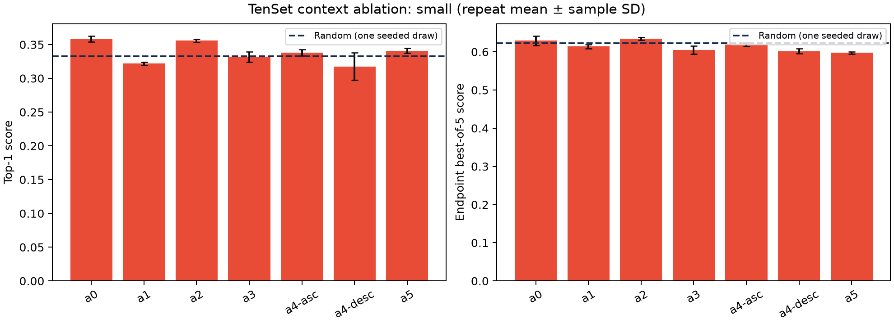
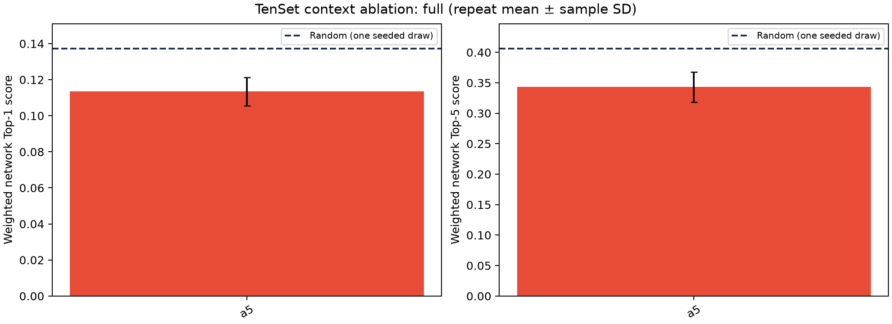

# TenSet context-engineering ablation: reviewed results

The completed study contains **2,601 decisions in 24 runs**: seven conditions
with three Jev repeats on the frozen 120-workload E5 cohort, followed by three
repeats of filtered A5 on all 27 ResNet-50 task types on Platinum-8272. The full
phase is an A5 follow-up, not a seven-condition full-network factorial.

These are reviewed **derived summary exports** from the uploaded result bundle.
The original predictions, immutable receipts, raw API caches, prepared shards,
and source measurement files were unavailable for this review. The summary
arithmetic checks below do not independently verify actual API payloads or
runtime labels. No new model requests were made to publish these files.

## Protocol and coverage

Jev 1.14.0 uses long context, opaque candidate aliases, the fixed decision
question, and a common seeded base order (`42:<workload_id>`). Every decision
uses one Choice question. Repeats retain the same presentation order and have
separate caches; they measure response variation, not shuffled-order variation.

| Phase | Workloads | Original candidate records | Shown to A5 per repeat | Jev decisions |
|---|---:|---:|---:|---:|
| Small factorial | 120 | 6,000, with 50 per workload | 1,200, with 10 per workload | 2,520 |
| Full ResNet-50 A5 follow-up | 27 task types, 56 occurrences | 100,126 | 1,320, with at most 50 per task | 81 |

The full source pools comprise 25 pools of 4,000 records, one of 20, and one of
106. A5 prunes 26 pools; the 20-record pool remains complete. All original
candidates remain in the scoring reference even when Jev sees a subset.

| Variant | Added descriptions | Candidate presentation |
|---|---|---|
| A0 | None; raw program context and schedules remain | All 50, seeded shuffle |
| A1 | Candidate transformation syntax | Same candidates and order as A0 |
| A2 | Graph field specification | Same candidates and order as A0 |
| A3 | Both descriptions | Same candidates and order as A0 |
| A4 ascending | Both | Ascending structural feature tuple |
| A4 descending | Both | Descending structural feature tuple |
| A5 | Both | Deterministic structural diversity subset, retaining base order |

The diversity filter is a runtime-blind farthest-first selection over normalized
schedule features. Its features summarize transformation counts, split factors,
annotation codes, and unroll pragmas. Structural order is a presentation control,
not a predicted speed order. This differs from TpuGraphs' training-informed
largest-tile ordering/filtering heuristic. Neither measured runtimes nor the
oracle diagnostics are inputs to this selection rule.

## Small-cohort results

Values are means across three repeat aggregates, with sample SD. Higher scores
and lower regret are better. Scores are normalized runtime-quality measures,
not the fraction of workloads where the exact fastest schedule was selected.

| Variant | Top-1 score | Endpoint Top-5 score | Mean runtime regret | Same first pick in all repeats |
|---|---:|---:|---:|---:|
| A0 naive | 0.3582 ± 0.0045 | 0.6293 ± 0.0123 | 5.0731 | 66.7% |
| A1 candidate definitions | 0.3218 ± 0.0021 | 0.6140 ± 0.0052 | 5.3747 | 70.0% |
| A2 graph specification | 0.3557 ± 0.0024 | 0.6344 ± 0.0035 | 4.9603 | 70.8% |
| A3 both | 0.3319 ± 0.0076 | 0.6046 ± 0.0105 | 5.2227 | 69.2% |
| A4 ascending | 0.3380 ± 0.0049 | 0.6188 ± 0.0049 | 4.5372 | 65.0% |
| A4 descending | 0.3176 ± 0.0203 | 0.6017 ± 0.0065 | 7.0874 | 66.7% |
| A5 diversity filter | 0.3410 ± 0.0037 | 0.5976 ± 0.0030 | 5.5204 | 82.5% |
| Random-42, one draw | 0.3324 | 0.6229 | 6.0589 | Not repeated |

A0 has the highest mean Top-1 score; A2 has the highest mean endpoint Top-5
score. Adding descriptions does not consistently improve this cohort. These
aggregate changes are not universal per-workload effects: for example, A1
improves Top-1 over A0 on 32 workloads and worsens it on 41, with 47 ties and
an exploratory unadjusted sign-test p-value of 0.349. The graph-only contrast
has 28 improvements and 27 degradations. Three-repeat SDs are not confidence
intervals or a substitute for paired workload analysis.

A5 reduces median decision latency from A3's 485.7 ms to 189.1 ms, about 61%.
It offers no consistent accuracy improvement over A3: Top-1 improves on 54
workloads and worsens on 52 (14 ties; p = 0.923). Endpoint Top-5 is slightly
lower in the mean. Filtering retains an original-pool optimum in 22/120
workloads. The exact expected Top-1 score of filtered-pool Random is 0.3082,
versus 0.3185 before filtering; the filter itself does not enrich fast
configurations under this metric. Jev improves Top-1 selection within the
filtered pool, while its endpoint Top-5 score 0.5976 is slightly below the
filtered Random expectation 0.6016.

## Full-network follow-up

The primary full-network endpoint is a ratio of sums of task-frequency-weighted
private normalizers and selected latencies, using the pinned paper evaluator's
float32-origin throughput labels and `1e-5` throughput floor. It is separate
from the macro task scores above and is an offline latency proxy, not a timed
end-to-end ResNet execution on the Mac.

| Model | Weighted network Top-1 score | Weighted network Top-5 score |
|---|---:|---:|
| Jev A5, three-repeat mean ± SD | 0.11342 ± 0.00775 | 0.34315 ± 0.02480 |
| Random-42, one full-pool draw | 0.13733 | 0.40633 |

All three Jev repeats are below this Random draw on both endpoints. A5 retains
the exact optimum in only 1/27 task pools, but near-optimal records remain:
the retrospective weighted-network oracle ceiling within the shown pools is
approximately 0.71374. This is a label-dependent upper bound, not an attainable
model prediction or an expected Random score.

The full macro task Top-1 score is 0.26782, exceeding the expected filtered
Random score 0.21954. Its macro endpoint Top-5 score 0.43306 is below filtered
Random's 0.46372. These macro expectations cannot be compared directly with
the weighted network ratios in the table. A ratio of expected latency sums
would also differ from an expected network score.

The [historical unfiltered ResNet-50 study](../paper-resnet50/README.md) used
different context, seed, and tournament execution. Its Jev network scores
0.09772/0.27458 are lower than this follow-up's, but the difference does not
isolate the filter's effect. Its Random-0 draw also differs from this study's
Random-42 reference. Published MLP values in that historical comparison remain
external, unpaired references; no trained paper model was executed here.

The published full-network figure is redrawn from the supplied numerical tables
with axis limits that include the Random reference lines and all error bars.
The original uploaded figure clipped both Random lines above its axis limits;
the original files remain unchanged outside Git and their hashes are retained
in the provenance record.

## Metrics, cost, and review limits

- `top_5_score` is the mean of normalized best runtimes over prefixes 1 through
  5. `endpoint_top_5_score` uses the best schedule among the first five picks.
  Both are retained in CSV exports; the endpoint is used in the comparison
  figures. `paper_network_top_*` is a distinct full-network aggregation.
- Pairwise metrics preserve the actual single-question probabilities and ties.
  They are omitted for filtered tails because those candidates were not ranked
  by Jev. A5 questions that retain their entire original pool remain valid
  single-question pairwise cases.
- All 2,601 saved requests are reported live, with zero cached requests and
  119,921,175 input tokens. This count already includes the pilot requests;
  they must not be added again. At the assumed $0.042 per million input tokens,
  the recorded successful input estimate is **$5.03668935**. The full A5 stage
  accounts for 81 requests, 4,246,344 input tokens, and $0.178346448 of that
  total. Output fees, unlogged retries, and billing reconciliation are excluded.
- The review verifies frozen-study identity, all 16 recorded implementation
  hashes against the publication tree, the complete decision inventory, run
  aggregates from exported per-workload metric values, repeat means/SDs,
  paired sign-test arithmetic, seeded Random candidate order, weighted-network
  arithmetic from exported endpoints, and usage/cost totals. It does not
  recompute primary timing scores or exact per-workload Random expectations
  from unavailable raw runtime labels, or independently audit wire contents.

## Files

- [summary.md](summary.md) and [summary.json](summary.json): supplied numerical
  summaries, with the private output directory sanitized in the JSON copy.
- [variants.csv](variants.csv), [runs.csv](runs.csv), and
  [per_workload.csv](per_workload.csv): repeat aggregates and per-workload metrics.
- [paired.csv](paired.csv): exploratory repeat-averaged paired comparisons.
- [baselines.csv](baselines.csv),
  [baseline-aggregates.csv](baseline-aggregates.csv), and
  [random-reference.csv](random-reference.csv): full/filtered Random expectations,
  filter-oracle diagnostics, and the seeded Random draw.
- [audit-summary.json](audit-summary.json) and [provenance.json](provenance.json):
  consistency checks, original-source hashes, implementation fingerprints,
  publication transformations, and verification limits.
- [protocol.json](protocol.json): compact frozen-design settings and workload
  counts, weights, normalizers, and input/label fingerprints. It omits candidate
  ID inventories and private paths, and is not an executable replacement for
  the original study. Reviewers can combine its full-phase normalizers and
  weights with `per_workload.csv` endpoint scores to reconstruct the weighted
  network ratios: selected latency is `normalizer / endpoint_score`, and the
  network score is `sum(weight * normalizer) / sum(weight * selected_latency)`.

Original uploads are preserved outside Git. The full candidate inventory,
complete Random rankings, raw requests/responses, source datasets, credentials,
and private local paths are excluded from this publication.
