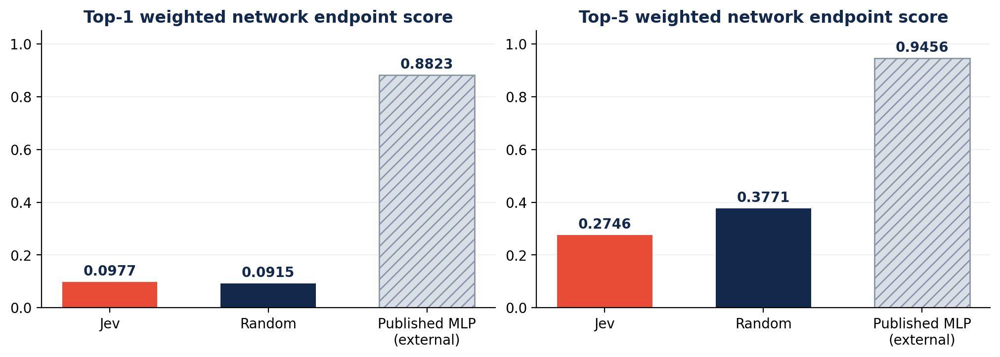
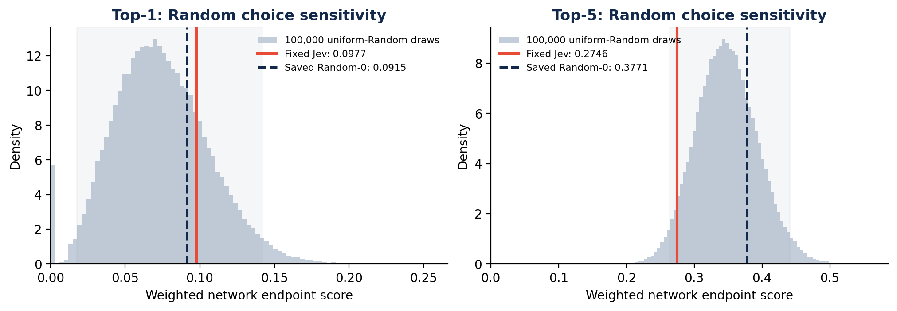
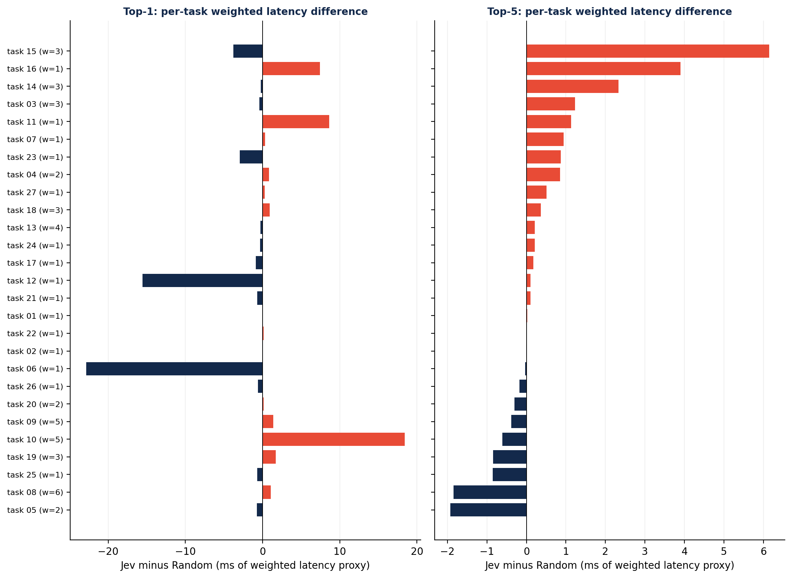

# Reviewed ResNet-50 network results

The completed run at `f6a2a49f6b2d0dc8b3ae2e9f87ca6b3250d929ea`
evaluates **one reconstructed ResNet-50 network**, batch 1, input
`(1, 3, 224, 224)`, against recorded Platinum-8272 measurements. It covers
**27 distinct tasks, 56 task occurrences, and 100,126 candidate records**.
Twenty-five task pools contain 4,000 records; the other two contain 20 and 106.
Jev and Random receive identical complete pools, including duplicate schedules
and recorded error-cost rows. There is no within-task train/test split.

The empirical comparison is Jev versus Random. The Table 4 **MLP + Ranking
loss** result is a separately labelled external reference: its original test
inventory and checkpoint have not been matched. These are saved results and
offline audits; publishing them made no new model requests.

## Endpoint network scores

| Model | Evidence | Top-1 | Top-5 |
|---|---|---:|---:|
| Jev 1.14.0 | Saved decisions on the local paired pools | 0.097724 | 0.274583 |
| Random-0 | Saved decisions on the same local pools | 0.091462 | 0.377121 |
| MLP + Ranking loss | External published reference, unpaired | 0.8823 | 0.9456 |

Jev is slightly higher than the saved Random-0 result at Top-1
(difference +0.006262), and lower at Top-5 (−0.102539). These normalized
scores are not optimum-hit accuracy. The 27 tasks are components of one
network, rather than 27 independently sampled networks.

The pinned network evaluator computes a ratio of task-frequency-weighted
latency sums. For each task, Top-5 uses the best candidate among the first
five predictions. It does not average prefix scores or task-level ratios.
Float32-origin minima/labels, a `1e-5` throughput floor, and float64 latency
recovery match the recorded evaluator contract. Full precision is retained
in [comparison.csv](comparison.csv) and
[endpoint-scores.csv](numerical/endpoint-scores.csv).

The corresponding network regret is `1 / endpoint_score - 1`, using exactly
the same task weights, oracle and recovered latency proxy:

| Model | Top-1 network regret | Top-5 network regret |
|---|---:|---:|
| Jev | 9.232877 | 2.641892 |
| Random-0 | 9.933510 | 1.651668 |

Lower regret is better. These are ratios of weighted evaluator proxies, not
newly measured end-to-end inference times or macro mean task regrets. The
derived values are in [network-regret.csv](network-regret.csv).

## Random-choice reference and task sensitivity

An offline Monte Carlo analysis draws **100,000 independent uniform-Random
ordered selections without replacement within each task**, with seed 20261118.
It keeps the network, candidate pools, occurrence weights, labels and saved
Jev decisions fixed. The mean Random score is 0.074093 at Top-1 and 0.347949
at Top-5. In these draws, 77.934% of Random Top-1 scores fall below fixed Jev,
while only 4.680% of Random Top-5 scores do. Equivalently, **95.320% reach or
exceed the fixed Jev Top-5 score**.

These are conditional reference distributions and tail fractions, not
population confidence intervals, p-values, or measurements of fresh Jev
repeatability. The observed Random-0 result remains the measured baseline;
the Monte Carlo mean does not replace it. See the
[reference summary](random-reference/random-reference.json).

The [numerical audit](numerical/numerical-audit.json) also reports leave-task-out,
leave-leading-hash-group-out and hypothetical task-mixture sensitivity. Removing
one task can reverse the Top-1 advantage; all 27 leave-one-task-out Top-5
differences remain negative. These altered mixtures are descriptive checks,
not additional measured networks or population inference. Task contributions
are available for all 27 tasks.

## Tournament diagnosis

The saved tournament contains 673 questions: 636 in round 0, 35 in round 1,
and two in round 2. Two tasks use one round, 23 use two, and two use three.
All 25 multi-round task pools lose their full-pool optimum during round 0.
Only one of the 27 final Top-5 sets includes a full-pool optimum.

Probabilities are coarse: the median question has four distinct probability
values, and 25 of 27 final questions have a tie at the Top-5 boundary. The best
available finalist is tied at that boundary and excluded in 14 tasks, below
the boundary probability in 11, and included in two. This makes the recorded
tie-breaking and final ordering relevant, but does not establish a causal
effect of presentation order or ties.

A post hoc oracle-aware decomposition attributes **86.866% of excess Top-5
weighted proxy latency** to final selection among the surviving candidates,
10.255% to round-0 pruning, and 2.879% to later pruning. The best attainable
score within the saved finalist pools under privileged oracle selection is
0.742401. That ceiling is a diagnostic, not a prediction of an achievable
rerun. The [tournament audit](tournament/tournament-audit.json) and
[finalist diagnostics](tournament/finalist-selection-diagnostics.json) retain
the complete checks and definitions. Global Pairwise Accuracy is not reported
for the tournament's eliminated tail.

## Usage and estimated cost

| Scope | Responses | Input tokens | Input-cost estimate |
|---|---:|---:|---:|
| New successful live requests | 631 | 95,175,703 | $3.997380 |
| Historical cached responses | 42 | 5,585,849 | $0.234606 equivalent |
| All stored responses, including cache | 673 | 100,761,552 | $4.231985 equivalent |

The assumed rate is **$0.042 per million input tokens**. The total row already
includes the cache row; cached tokens are historical usage, not newly charged
inputs in this run. These input-only estimates exclude output charges,
unseen retries and invoice reconciliation. They are not invoices.
The [request accounting](tournament/request-accounting.csv) contains usage and
latency measurements without provider request IDs.

## Audit scope and published files

Independent checks reproduce all 54 full rankings, 108 endpoint decompositions,
the 27 Random-0 rankings, paired pool/runtimes/input-fingerprint equality,
tournament ordering/promotions, and usage totals. Forty implementation-source
hashes match the recorded execution. No concrete formula, units, weighting,
normalizer or paired-pool bug was found in the supplied exports.

Raw dataset records, the original task pickle, prepared shards and actual
transmitted API bodies were not supplied. Saved-output consistency cannot
independently establish those raw labels, original source identity, semantic
payload contents, or an exact reproduction of the paper's private checkpoint
and inventory. Sixty-seven saved failure-sentinel costs match the manifest's
declared error count; original error-code-to-record mapping remains unverified.
Detailed numerical conventions follow the pinned executable evaluator;
supplemental Appendix B/C was not independently inspected.

| File | Purpose |
|---|---|
| [comparison.csv](comparison.csv), [audit-summary.json](audit-summary.json) | Compact primary scores and consolidated reviewed findings |
| [network-regret.csv](network-regret.csv) | Derived network regret with the same score weights and oracle |
| [endpoint-scores.csv](numerical/endpoint-scores.csv), [paired-task-contributions.csv](numerical/paired-task-contributions.csv) | Full-precision endpoint reconstruction and all-task contributions |
| [numerical-audit.json](numerical/numerical-audit.json), [leave-out-sensitivity.csv](numerical/leave-out-sensitivity.csv) | Exact numerical checks and descriptive mixture sensitivity |
| [tournament-audit.json](tournament/tournament-audit.json), [finalist-selection-diagnostics.json](tournament/finalist-selection-diagnostics.json) | Recorded ranking, promotion, tie, elimination and usage checks |
| [tasks.csv](tournament/tasks.csv), [questions.csv](tournament/questions.csv), [request-accounting.csv](tournament/request-accounting.csv) | Compact per-task, per-question and request-accounting rows |
| [random-reference.json](random-reference/random-reference.json) | Conditional 100,000-draw uniform-Random reference summary |
| [protocol-audit.json](protocol/protocol-audit.json) | Source contract, implementation checks and raw-artifact limits |
| [provenance.json](provenance.json) | Original raw-input/audit checksums, published checksums and derivation notes |

Figures are supplied in PNG and SVG. Copied CSV values and JSON numerics are
preserved; text line endings and SVG trailing whitespace are normalized.
Original predictions, manifest, dataset, cache, credentials, provider request
IDs, ZIPs and the large Monte Carlo draw array are excluded from Git.

The [four-slide presentation](../../../presentations/tenset-rq1/README.md),
[protocol](../../../tenset-paper-protocol.md), and
[run guide](../../../run-tenset-paper-resnet50.md) provide presentation and
execution context. Keep the earlier
[484-workload tutorial](../tutorial-500-platinum-test/),
[E5 120-workload experiment](../w120-c50-s42-long-context/), and
[candidate-size study](../size-sweep/) separate: their cohorts, pool policies
and score aggregation differ.

Sources: [pinned TenSet network evaluator](https://github.com/tlc-pack/tenset/blob/35774ed373f9693cc6efcbe83f5703141e8ab0c8/scripts/eval_model_on_dataset.py)
and [main paper Section 5.2/Table 4, ResNet-50 column](https://datasets-benchmarks-proceedings.neurips.cc/paper_files/paper/2021/file/a684eceee76fc522773286a895bc8436-Paper-round1.pdf#page=7).
