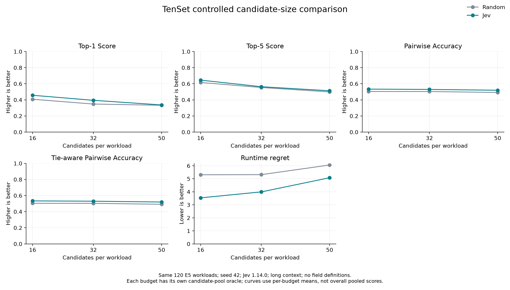
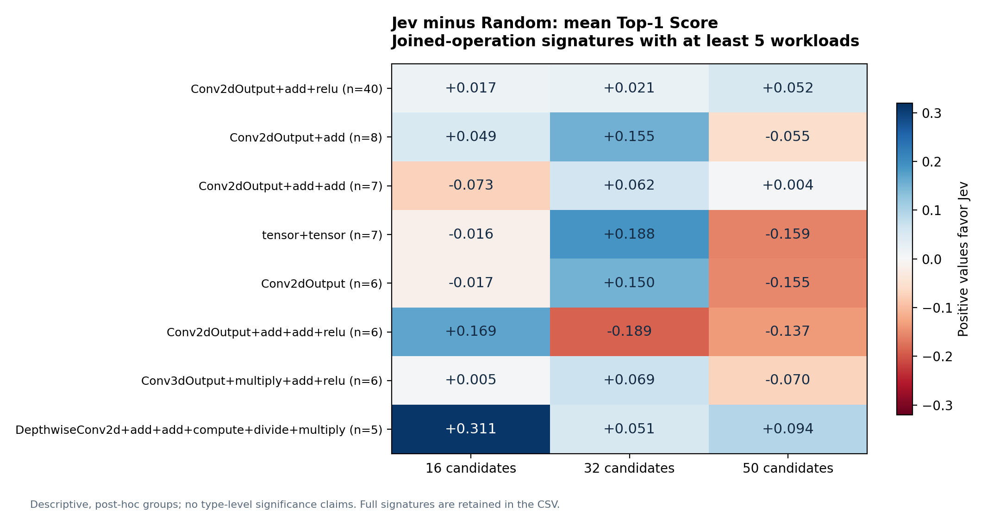

# E5 candidate-size comparison: 16, 32, and 50 schedules

This publication keeps the candidate budgets separate. The reported study uses
the same 120 E5-2673 workloads, sampling seed 42, Jev 1.14.0, long context,
single-question decisions, and no field definitions. It is designed around
nested prefixes of the same frozen 50-schedule pools.

The supplied per-workload exports contain the same 120 workload IDs for both
models at all three budgets. Their prepared-data checksum matches the
[previously audited 120 × 50 experiment](../w120-c50-s42-long-context/).
The 50-candidate results are historical results reused from that experiment.
They are not a new 50-candidate run.

**Verification limit:** original predictions, manifests, saved configurations,
cache responses, and the frozen size-sweep manifest were not supplied for the
new 16/32-candidate runs. Their uploaded aggregate and per-workload exports can
be checked for internal consistency; the actual candidate identities, nesting,
API settings, and runtime labels cannot be independently reconstructed from
these CSVs. Protocol claims below describe the reported design. The historical
50-candidate metric rows were independently checked against their earlier raw
predictions and agree within 1e−12.

## Per-budget metrics

All values are unweighted workload means **within each candidate budget**.
Top-1, Top-5, and Pairwise Accuracy are higher-is-better; regret is lower-is-better.
Top-5 averages the prefix-best score over the first five choices. Scores are
performance ratios, not optimum-hit accuracy.

| Candidates | Model | Top-1 | Top-5 | Pairwise Accuracy | Tie-aware PA | Runtime regret |
|---:|---|---:|---:|---:|---:|---:|
| 16 | Random-42 | 0.407439 | 0.615892 | 0.504097 | 0.504097 | 5.308322 |
| 16 | Jev | 0.456949 | 0.645309 | 0.533403 | 0.533715 | 3.535879 |
| 32 | Random-42 | 0.348193 | 0.553470 | 0.503461 | 0.503461 | 5.317561 |
| 32 | Jev | 0.394553 | 0.563148 | 0.529536 | 0.529940 | 3.993304 |
| 50 | Random-42 | 0.332440 | 0.498775 | 0.491959 | 0.491959 | 6.058854 |
| 50 | Jev | 0.336867 | 0.512829 | 0.519456 | 0.519704 | 5.081011 |

These are descriptive point estimates. The curves do not by themselves establish
statistical significance or fresh-call reproducibility. Each budget has a
different candidate-pool oracle, so changes in scores across budgets are not
direct physical runtime speedups.

The independent [audit summary](audit-summary.json) checks all uploaded group
tables against the per-workload exports and verifies continuity of the historical
50-candidate anchor. It does not recover missing 16/32-candidate raw decisions.

Exploratory intervals use 50,000 paired workload resamples with seed 20261116.
The same resampled workload indices are used across all budgets, preserving
within-workload dependence for the between-budget contrasts. The main intervals
do not cluster related programs. A supplementary leading-hash cluster analysis
is reported below. The twelve within-budget intervals plus eight between-budget
contrasts in each analysis are not adjusted for multiple comparisons.

| Candidates | Jev−Random Top-1, 95% interval | Jev−Random Top-5, 95% interval |
|---:|---|---|
| 16 | +0.049510 [−0.024313, +0.123654] | +0.029417 [−0.026415, +0.085218] |
| 32 | +0.046360 [−0.009531, +0.102266] | +0.009678 [−0.039755, +0.058687] |
| 50 | +0.004427 [−0.059905, +0.068146] | +0.014055 [−0.037057, +0.065127] |

All Top-1/Top-5 intervals include zero. Strict Pairwise Accuracy intervals are
positive at each budget under this unadjusted workload bootstrap. The regret
interval is below zero at 32 candidates, while the 16/50 intervals include zero.
Every 16-versus-50 and 32-versus-50 contrast of the Jev-minus-Random advantage
includes zero. These results do not establish a significant change in relative
model advantage with candidate count.

See [paired-comparison.csv](paired-comparison.csv),
[paired-statistics.json](paired-statistics.json), and
[between-budget-contrasts.csv](between-budget-contrasts.csv) for exact values.
The new common-bootstrap seed differs from the earlier standalone 50-candidate
audit, so its Monte Carlo percentile endpoints need not be identical.

The separate [cluster sensitivity](family-cluster-sensitivity.json) resamples
56 leading DAG-hash groups from the historical workload map, retaining all
members of each sampled group. The largest group has 25 workloads. These groups
are a proxy for dependence; independent network or program families have not
been verified. This sensitivity also uses 50,000 draws and seed 20261116. All
Top-1/Top-5 and between-budget advantage intervals still include zero. Strict
Pairwise Accuracy intervals remain positive at all three budgets, with the
16-candidate lower endpoint close to zero; only the 32-candidate regret interval
is below zero. These remain exploratory unadjusted results. See the
[per-budget table](family-cluster-comparison.csv) and
[between-budget contrasts](family-cluster-between-budget-contrasts.csv).

The uploaded per-budget figure is preserved, with SVG whitespace normalized.
Its plotted data are in [plot-data.csv](plot-data.csv), and original method hashes
and interpretation are recorded in [plot-method.json](plot-method.json).
No pooled overall score or pooled comparison figure is published. The 720 model
rows represent two models at three budgets over 120 workloads, rather than
720 independent workloads.

## Operation signatures and reported examples

The operation review independently reproduces all 162 uploaded operation
aggregates from the paired per-workload table. There are 27 literal operation
signatures; 19 contain fewer than five workloads, while the eight larger groups
cover 85 of the 120 workloads. These are composite names recorded in program
metadata, not inferred architecture families or independently sampled classes.
Group differences and examples are descriptive and post hoc.

Read the [operation review](operation-review.md), its [JSON](operation-review.json),
the [paired operation table](by-operation-paired.csv), and the
[budget-specific reported examples](posthoc-examples-by-budget.csv).
The uploaded files do not contain tensor shapes or full schedule-transformation
bodies. They identify favorable and unfavorable outcomes, but do not establish
the semantic reason Jev chose a schedule. The smaller original uploaded
[selected-cases.csv](selected-cases.csv) is retained with its original selection
policy; it should not be treated as exhaustive for each budget.

## Accounting

The accounting export reports 120 live decisions at 16 candidates and 120 at
32 candidates. Their new input usage totals **7,006,679 tokens**, equivalent to
**$0.294281** at the assumed $0.042 per million input tokens, with output free.
This is an estimate from reported successful usage, not an invoice.

The 50-candidate accounting belongs to the earlier run: 110 live and ten cached
responses. It is included for historical context and is excluded from new
size-sweep usage. Do not count those historical calls as new sweep requests.
See [accounting-by-budget.csv](accounting-by-budget.csv) for explicit scope labels.

## Published files

| File | Meaning |
|---|---|
| [metrics.csv](metrics.csv) | Six per-budget model means; no pooled total |
| [per-workload.csv](per-workload.csv) | All 720 reported model/workload/budget metric rows |
| [by-operation.csv](by-operation.csv), [by-run.csv](by-run.csv) | Original per-budget group and run aggregates |
| [summary.json](summary.json) | Compact typed metadata, protocol claims, per-budget means and verification limits |
| [decision-accounting.csv](decision-accounting.csv) | Reported per-workload accounting with request IDs removed |
| [accounting-by-budget.csv](accounting-by-budget.csv) | Usage sums with new 16/32 calls separated from historical 50 calls |
| [selected-cases.csv](selected-cases.csv) | Original exported high/low-score examples |
| [plot-data.csv](plot-data.csv), [plot-method.json](plot-method.json) | Uploaded per-budget plotted values and method provenance |
| [audit-summary.json](audit-summary.json), [paired-statistics.json](paired-statistics.json) | Independent export checks and exploratory paired uncertainty |
| [paired-comparison.csv](paired-comparison.csv), [paired-differences.csv](paired-differences.csv), [between-budget-contrasts.csv](between-budget-contrasts.csv) | Per-budget and repeated-workload comparisons kept separate |
| [family-cluster-sensitivity.json](family-cluster-sensitivity.json), [family-cluster-comparison.csv](family-cluster-comparison.csv), [family-cluster-between-budget-contrasts.csv](family-cluster-between-budget-contrasts.csv) | Supplementary leading-hash dependence sensitivity; groups are not verified independent families |
| [usage-summary.json](usage-summary.json) | Independently checked usage with historical 50-candidate costs separated |
| [operation-review.md](operation-review.md), [operation-review.json](operation-review.json) | Independent operation-aggregate and descriptive example review |
| [by-operation-paired.csv](by-operation-paired.csv), [posthoc-examples-by-budget.csv](posthoc-examples-by-budget.csv) | Joined model differences, group counts, and examples kept separate by budget |
| [audit_size_sweep.py](audit_size_sweep.py) | Portable offline audit and bootstrap procedure for the original exported files |
| [family_cluster_sensitivity.py](family_cluster_sensitivity.py) | Portable supplementary leading-hash cluster bootstrap |
| [provenance.json](provenance.json) | Archive/input hashes, de-identification changes and missing-artifact limits |

Input SHA-256 values in review metadata identify original uploaded files.
Published CSVs use LF line endings; their own hashes are listed separately in
provenance.json. Private local source paths and request IDs are not published.
The original archive and extracted source files are preserved outside Git.

To repeat the audit, extract the original uploaded archive and point the script
at that original directory, containing analysis/ and size-comparison/:

~~~bash
uv run --extra tenset python docs/results/tenset/size-sweep/audit_size_sweep.py \
  --input-dir /path/to/original-extracted-upload \
  --output-dir /path/to/new-offline-audit \
  --replicates 50000 \
  --seed 20261116
~~~

To repeat the historical anchor check, additionally supply
--historical-predictions with the original 50-candidate predictions.jsonl path.
The audit verifies original method-file hashes. The de-identified, renamed,
LF-normalized publication is not a byte-identical substitute for the original
export tree. The script makes no model requests and does not load credentials.

To repeat the separate cluster sensitivity using the existing historical map:

~~~bash
uv run --extra tenset python docs/results/tenset/size-sweep/family_cluster_sensitivity.py \
  --per-workload /path/to/original-extracted-upload/analysis/per_workload.csv \
  --family-map docs/results/tenset/w120-c50-s42-long-context/paired-workloads.csv \
  --output-dir /path/to/new-cluster-sensitivity \
  --replicates 50000 \
  --seed 20261116
~~~

Keep this E5 valid-schedule, full-ranking study separate from the
[484-workload Platinum tournament](../tutorial-500-platinum-test/). The targets,
cohorts, candidate policies, aggregation, and invalid-record handling differ.
Their empirical comparisons remain Jev versus Random. Published XGBoost
scores from the Platinum tutorial are supplied separately as
[external context](../tutorial-500-platinum-test/xgboost-tutorial-reference.json),
with original test identities and checkpoint unverified. They are not a
matched baseline for these E5 candidate-size rows.
