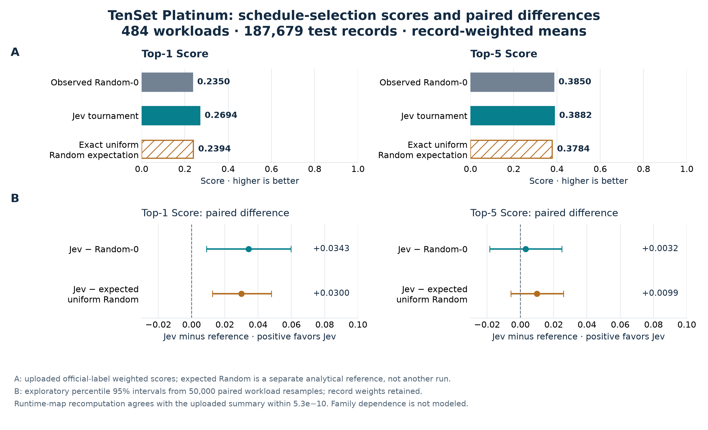
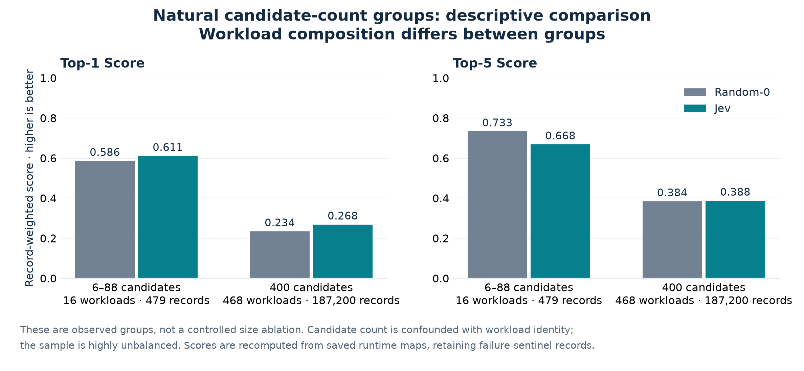
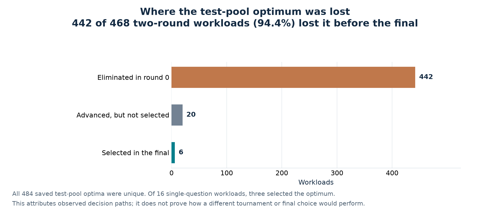

# Reviewed Platinum test-pool results: Jev versus Random

This directory publishes reviewed derived outputs for the completed
tenset-tutorial-500-platinum-test run at commit ed73f19. The empirical
comparison contains **Jev and Random only**. It is separate from the earlier
[120-workload E5-2673 experiment](../w120-c50-s42-long-context/).

The preparation sampled 500 files using the pinned TenSet tutorial's
batch-size-1 procedure and seed 0. Its 48-record minimum retained 484 workloads.
The reverse-order 90/10 split within each workload produced 187,679 test
records, with 6–400 candidates per workload. These are test schedule records
from the retained workloads, not 484 entirely unseen programs.

Jev used version 1.14.0, field definitions, long context, opaque shuffled
candidate IDs, at most 255 choices per question, and five advancing candidates
per group. Both models evaluated identical frozen candidate pools.

## Results and interpretation

| Record-weighted score | Observed Random-0 | Jev |
|---|---:|---:|
| Top-1 | 0.2350454330 | 0.2693555645 |
| Top-5 | 0.3850208696 | 0.3882448622 |

Higher scores are better; 1.0 is optimal for the presented test pool. Top-5 is
the average prefix-best score over the first five choices. These scores are
neither optimum-hit accuracy nor physical runtime speedups.

| Paired difference, Jev minus reference | Difference | Exploratory 95% interval |
|---|---:|---:|
| Top-1 versus observed Random-0 | +0.034310 | +0.009015 to +0.059739 |
| Top-5 versus observed Random-0 | +0.003224 | −0.018344 to +0.024936 |
| Top-1 versus exact uniform-Random expectation | +0.029951 | +0.012579 to +0.048034 |
| Top-5 versus exact uniform-Random expectation | +0.009865 | −0.005705 to +0.025934 |

The exact uniform-Random expectation is an additional offline analytical
reference: Top-1 0.239404 and Top-5 0.378379. It does not replace the observed
Random-0 result or count as another experiment.

The intervals resample 484 workload pairs together, retain their test-record
weights, and recompute the weighted ratio of sums. They use 50,000 percentile
bootstrap replicates with seed 20261116. They are exploratory, unadjusted, and
conditional on the saved cohort and decisions. Related workload-family
dependence is not modeled. Neither the intervals nor a cached rerun establish
fresh API repeatability or generalization to new program families.

Jev had a higher Top-1 score on 278 workloads and a lower one on 206. It selected
the unique test-pool optimum on nine workloads, versus six for Random. Top-5
differences remain uncertain.

## Published XGBoost tutorial reference

The pinned [TenSet 500-file tutorial](https://github.com/tlc-pack/tenset/blob/35774ed373f9693cc6efcbe83f5703141e8ab0c8/docs/try_pretrained_models_on_aws_c59x.md#L78)
reports these XGBoost values. This is an external tutorial result, rather than
a table from the TenSet paper or an additional model run in our experiment.

| Published tutorial metric | XGBoost external reference |
|---|---:|
| Top-1 / average peak score@1 | 0.829146 |
| Top-5 / average peak score@5 | 0.904636 |
| Pairwise Accuracy | 0.846439 |
| RMSE | 0.080881 |

The tutorial samples 500 Platinum-8272 files and trains XGBoost on 1,689,022
records, with 187,679 test records under a seed-0, 90/10 within-task split.
Its printed test-size list contains 484 workloads. These counts agree with
our reconstruction, but the original tutorial test inventory and trained
checkpoint have not been matched, and we did not run XGBoost locally.

The published Top-1/Top-5 values are numerically higher than our Jev scores
of 0.269356/0.388245. Treat that as cross-study context: it does not establish
a paired comparison, a significance result, or a controlled performance gap.
The Jev-versus-Random tables and intervals above remain the measured comparison.
The tutorial's Pairwise Accuracy also has no matching global Jev tournament
ordering to compare against.

The TenSet repository supports a Random model, but this 500-file tutorial does
not publish its Random-model scores. The observed Random-0 result above is
our own run; the exact uniform-Random expectation is our separate analytical
reference. See [xgboost-tutorial-reference.json](xgboost-tutorial-reference.json)
and [.csv](xgboost-tutorial-reference.csv) for the exact values, pinned source
commit, document lines, checksums, protocol evidence, and comparison limits.

## Candidate counts and tournament diagnostics

The natural size groups are highly unbalanced: 468 workloads have 400 candidates
each, while 16 have 6–88. Workload identity and candidate count differ together.
The grouped table and figure are descriptive; they do not establish a causal
effect of candidate-set size.

Among 468 two-round workloads, 442 lost the test-pool optimum in round 0.
Twenty-six advanced it; six selected it in the final and 20 did not. Three of
the 16 single-question workloads selected their optimum. These counts describe
the recorded paths, not what an alternative grouping or final decision would do.

The manifest reports 2,013 test error records. The saved runtime maps contain
the same number of expected failure-sentinel values; Jev selected such a value
eight times and Random seven. Original error codes were not uploaded, so these
are sentinel checks rather than an independent raw failure-status audit. No
physical mean-runtime regret is inferred from those artificial penalties.
Global Pairwise Accuracy is omitted because the tournament's eliminated tail
is not a globally learned ordering.

## Usage and estimated cost

| Scope | Requests/responses | Input tokens | Estimated input cost |
|---|---:|---:|---:|
| New successful live requests in the full run | 1,840 | 179,522,529 | $7.539946 |
| Previously cached pilot responses | 16 | 1,880,950 | $0.079000 equivalent |
| All distinct stored responses, including the pilot | 1,856 | 181,403,479 | $7.618946 equivalent |

The last row already includes the pilot. Do not add it to the new-usage row.
The assumed rate is $0.042 per million input tokens, with output free. These
are input-cost estimates, not invoices; unlogged retries, unsuccessful calls,
or provider billing adjustments cannot be reconstructed from these artifacts.

Mean decision latency was 4.102 seconds per workload including cached cases,
or 4.127 seconds among wholly live workloads. Mean live API latency was
1.022 seconds per request, a different unit. Cached access is reported separately.

## Files and provenance

| File | Meaning |
|---|---|
| [metrics.csv](metrics.csv), [summary.json](summary.json) | Reviewed uploaded label-based weighted scores and separately named macro means |
| [paired-workloads.csv](paired-workloads.csv) | Per-workload runtime-based score recomputation, outcomes, optimum hits and sentinel flags |
| [paired-statistics.json](paired-statistics.json) | Independent metric audit, paired uncertainty, wins, and selected cases |
| [exact-random-expectation.json](exact-random-expectation.json), [.csv](exact-random-expectation.csv) | Exact uniform-Random expectation and separately labelled comparisons |
| [xgboost-tutorial-reference.json](xgboost-tutorial-reference.json), [.csv](xgboost-tutorial-reference.csv) | Published XGBoost tutorial output as separate external context; no locally matched XGBoost run |
| [by-candidate-count.csv](by-candidate-count.csv), [method note](by-candidate-count-method.json) | Descriptive natural candidate-count groups |
| [tournament-diagnostics.json](tournament-diagnostics.json) | Recorded elimination paths, per-question probability ties and option-count groups |
| [usage-summary.csv](usage-summary.csv), [usage-independent.json](usage-independent.json) | Live/cache accounting, latency and assumed-rate cost estimates |
| [provenance.json](provenance.json) | Original input checksums, run identity, scope, derivation changes and audit limits |
| [make_plots.py](make_plots.py) | Portable figure regeneration from these adjacent exports |

Each figure is available as PNG and SVG. To regenerate them from the repository
root, run:

~~~bash
uv run --extra tenset python \
  docs/results/tenset/tutorial-500-platinum-test/make_plots.py
~~~

Original predictions.jsonl, manifest.json, saved YAML, and prepared data are
not committed here. This is a derived publication, not a copy of the original
result bundle. Runtime-based recomputation agrees with the uploaded
official-label summary within 5.3e−10. Raw measurements, private float32 labels,
prepared shards, and actual API request bodies were not supplied, so exact
original-label reconstruction and semantic request-content validation are not
claimed.

CSV line endings are normalized to LF. Metadata references to published CSV
hashes are updated and original audit hashes are retained. Obsolete external
baseline metadata is removed for the revised Jev-versus-Random scope, and pricing
attribution is corrected to an assumed audit rate. Numerical results are unchanged.
Generated SVG whitespace is normalized without changing the plotted data.
The archived historical tutorial-inventory verification status does not block
the within-run comparison of Jev and Random on identical saved pools.
The published XGBoost reference is now provided in separate files; it does not
modify that measured-study metadata or add a locally evaluated model.
