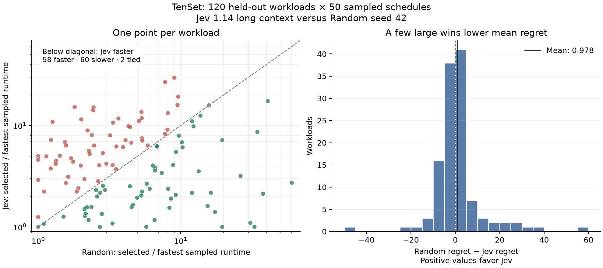

# Run log — RQ1 TenSet

A record of completed TenSet experiments and separately labelled offline
analyses. This follows the TpuGraphs [run-log format](https://github.com/Jonghu/jev-ml-compiler-eval/blob/61fe406/docs/runlog.md).
Dates below use America/Chicago; UTC completion timestamps are also given.
Prepared follow-up profiles are listed at the end and are not completed runs.

## Shared setup

| Item | Value |
|---|---|
| Dataset | Official TenSet CPU v3.3, Intel E5-2673 v4 collection |
| Exact target | `llvm -keys=cpu -link-params=0 -mcpu=core-avx2 -model=e5-2673` |
| Experimental unit | One tensor workload and its candidate schedules |
| Evaluation | Offline selection against existing CPU measurements; requests run from the user's Mac |
| Measurements | Mean timing repetitions per record, then mean repeated schedule records; seconds converted to milliseconds |
| Invalid records | Failed, empty, nonfinite, nonpositive, and failure-sentinel timings excluded |
| Splits | Project-defined workload-key hash, seed 42: approximately 70% train, 10% validation, 20% test |
| Candidate sampling | Seeded hash of workload ID and schedule ID, independent of runtime values |
| Models | Uniform Random ranking, seed 42; pinned `jev-1.14.0` |
| Jev question | "Which candidate is most likely to have the lowest runtime for this workload?" |

Top-1 and Top-5 Score are higher-is-better normalized-throughput ratios.
Top-5 Score averages the best score at each prefix of the first five choices;
it is not just the best-of-five endpoint. Pairwise Accuracy follows TenSet's
strict comparisons, with a separately named tie-aware diagnostic. Runtime
regret is `selected / fastest_candidate - 1`, where the oracle is limited to
the candidates presented in that run. Results are workload macro means.

Original generated bundles remain outside Git, as in the TpuGraphs workstream.
Reviewed tables, figures, audit methods, and input checksums are published under
[docs/results/tenset](results/tenset/README.md). A published derived table is
not an additional experiment or an original result-bundle file.

## R1 — One-workload setup pilot, eight schedules

- Completed: 2026-11-05, 22:31 CST (`2026-11-06T04:31:48.980732Z`).
- Recorded code commit: `de0fb6ae34e340696ce867938c2733564ca52e58`.
- Config: `experiments/tenset/jev-vs-random.yaml` at that commit.
- Output: `results/tenset/random-vs-jev-c8-s42/`, outside Git.
- Scope: one workload, eight schedules, `split: all`; this case is train-labelled
  by the project hash split and is a setup check, not a held-out benchmark.
- Jev used default context; requested and resolved versions were `jev-1.14.0`.
- One live Jev call: 16,460 input tokens, 275 output tokens; API latency
  554.943 ms and total decision latency 555.785 ms.

| Model | Workloads | Schedules | Top-1 Score | Top-5 Score | Pairwise Accuracy | Runtime regret |
|---|---:|---:|---:|---:|---:|---:|
| Random-42 | 1 | 8 | 1.000000 | 1.000000 | 0.821429 | 0.000000 |
| Jev 1.14 | 1 | 8 | 1.000000 | 1.000000 | 0.571429 | 0.000000 |

The uploaded five-file bundle was independently inspected. Both models selected
the unique fastest candidate, 0.23013625 ms; the second-fastest took
0.479597125 ms. Jev correctly ordered 16 of 28 pairs, versus Random's 23.
The second-fastest schedule appeared last in Jev's ranking.

The perfect selection score is exact, with no runtime ties or rounding issue.
It describes one successful choice, not 100% accuracy across TenSet. The optimum
also happened to be the first presented candidate, so this case alone cannot
rule out presentation-order effects. Metadata enrichment preserved an outdated
status string in the original provenance; it did not affect metric computation.

## R2 — Default-context, 50-schedule canary rejected

- CLI profile: `experiments/tenset/local/jev-vs-random-w10-c50-s42.yaml`,
  generated locally before the long-context change.
- The API returned HTTP 400 with `error_type: max_tokens_exceeded`.
- No completed result bundle or success metrics were supplied for this run.

Offline diagnostics showed request sizes of approximately 26–216 KB among
the first ten cases. One program context alone was about 80 KB, so reducing
candidate count alone could not guarantee admission. The local 262,144-byte
guard was not a service token limit. No claim is made about charges for failed
requests, which are not included in the successful-response accounting below.

## R3 — 120 test workloads, 50 sampled schedules, long context

- Completed: 2026-11-11, 23:20 CST (`2026-11-12T05:20:00.163188Z`).
- Recorded code commit: `6a4fe91585df2f91e347bfbc7be2fb8bde325df0`.
- Tracked reference config at that commit:
  `experiments/tenset/jev-vs-random-w120-c50-s42-long-context.yaml`.
- Original output: `results/tenset/random-vs-jev-w120-c50-s42-long-context/`,
  outside Git. The original saved `experiment.yaml` was not uploaded for this
  run; the tracked reference is not represented as a copy of that file.
- Environment: Python 3.11.18, TypeSafe SDK 0.7.5, NumPy 2.4.6,
  Matplotlib 3.11.2.
- All 120 decisions requested and resolved `jev-1.14.0`; prediction metadata
  records `long_context: true` throughout. This opts into the documented
  `TypeSafe-Danger-Zone-Long-Context: true` header.
- Scope: 120 project-test workloads, exactly 50 sampled schedules each,
  required tensor-program metadata, seed 42, one Choice question per workload.
- Source preparation indexed 2,308 platform files and 448 test groups. It
  processed 122 groups to retain 120 eligible workloads; the two exclusions
  had 19 and 20 valid distinct schedules. Processed records: 448,713 total,
  439,211 valid, 9,502 invalid.

| Model | Workloads | Schedules each | Top-1 Score | Top-5 Score | Pairwise Accuracy | Tie-aware Pairwise Accuracy | Runtime regret |
|---|---:|---:|---:|---:|---:|---:|---:|
| Random-42 | 120 | 50 | 0.332440 | 0.498775 | 0.491959 | 0.491959 | 6.058854 |
| Jev 1.14, long context | 120 | 50 | 0.336867 | 0.512829 | 0.519456 | 0.519704 | 5.081011 |

Exact values are in [metrics.csv](results/tenset/w120-c50-s42-long-context/metrics.csv).

| Selection diagnostic | Value |
|---|---:|
| Jev selects a faster schedule than Random | 58 / 120 |
| Jev selects the same runtime | 2 / 120 |
| Jev selects a slower schedule | 60 / 120 |
| Jev selects the unique sampled optimum | 5 / 120 (4.17%) |
| Random selects the unique sampled optimum | 5 / 120 (4.17%) |
| Jev optimum appears in its first five predictions | 14 / 120 |
| Random optimum appears in its first five predictions | 13 / 120 |

Top-1 Score 0.336867 is not a 33.7% optimum-hit rate. Mean regret is 16.1%
lower than the observed Random-42 result, but that average is sensitive to
large gains on a few workloads. Median regret is 3.081662 for Jev and
3.025676 for Random. All 120 cases remain in the primary result.

### Integrity audit

The uploaded `predictions.jsonl` and `manifest.json` contain 240 predictions,
120 per model. Every pair has identical ordered candidate IDs, runtime maps,
and recorded model-input fingerprints. All five metrics recompute exactly for
all rows. Every Random ranking reproduces from seed 42 and its workload hash;
Jev probabilities cover the exact candidate set, are finite, sum to one, and
agree with the selected candidate and saved ranking.

The manifest's source workload keys reproduce the declared test splits and
workload IDs. The [provenance record](results/tenset/w120-c50-s42-long-context/provenance.json)
includes input-file and prepared-data SHA-256 hashes. Raw measurements, the
prepared artifact, and actual request payloads were not uploaded, so runtime
aggregation, semantic completeness, and absence of labels inside actual
requests were not independently rechecked from these two files.

## A1 — Offline paired uncertainty and outlier analysis

This analysis uses the saved R3 choices and labels, with no additional API calls.
The primary diagnostic resamples workload pairs together, with 50,000 bootstrap
replicates and seed 20261112. Intervals are percentile 95% intervals, exploratory
and unadjusted for multiple metrics. Deltas below are **Jev minus Random-42**;
negative regret differences favor Jev.

| Metric | Mean difference | Paired workload-bootstrap 95% interval |
|---|---:|---:|
| Top-1 Score | +0.004427 | −0.059112 to +0.068515 |
| Top-5 Score | +0.014055 | −0.036992 to +0.065099 |
| Pairwise Accuracy | +0.027497 | +0.014292 to +0.040782 |
| Runtime regret | −0.977843 | −2.982630 to +0.906991 |

The Pairwise Accuracy difference is 2.75 percentage points. It remains positive
in a separate sensitivity check resampling 56 leading DAG-hash families,
including a largest family of 25 workloads. These hashes are not verified
independent networks. The intervals therefore describe exploratory uncertainty
for this cohort and do not establish performance on unseen programs or hardware.

The three largest favorable regret differences are 57.502979, 35.828305,
and 32.024633. Together they exceed the total net regret improvement across
all cases. Removing those cases changes the mean Random-minus-Jev regret gap
to −0.068502. This is a post-hoc sensitivity diagnostic, not a reason to remove
them from the reported experiment. Median paired runtime ratio Jev/Random is
1.025154, consistent with the nearly even per-workload win/loss count.

Probability ties are frequent: each Jev response has only three to nine distinct
probability values, and 30 workloads have multiple candidates tied for maximum
probability. The official and tie-aware aggregate accuracies are nevertheless
close; the report retains both definitions.

## A2 — Exact uniform-Random expectation, separate analytical reference

All 50 candidate runtimes are available for each R3 workload. Uniform Random's
expected Top-1 Score and regret can therefore be computed exactly by averaging
over its 50 possible first choices. Expected Top-5 Score uses the exact minimum
order-statistic distribution for each prefix, without enumerating 50! rankings.
This is not another run and does not replace the saved Random-42 values.

| Reference | Top-1 Score | Top-5 Score | Runtime regret |
|---|---:|---:|---:|
| Exact uniform-Random expectation | 0.318459 | 0.494099 | 6.762689 |
| Observed Random-42 | 0.332440 | 0.498775 | 6.058854 |
| Observed Jev 1.14, long context | 0.336867 | 0.512829 | 5.081011 |

Against this exact reference, mean Jev-minus-expected-Random regret is
−1.681678. Its exploratory DAG-family bootstrap interval is −2.476098 to
−0.629261; Top-1 and Top-5 difference intervals still include zero. This supports
lower average regret than uniform Random expectation on the fixed cohort,
while selection performance against the single observed Random-42 ranking
remains mixed. The reference method and per-workload values are published in
[expected-random.json](results/tenset/w120-c50-s42-long-context/expected-random.json).

## A3 — Live usage, cached responses, latency, and estimated cost

Ten cached responses are exactly the first ten workload inputs, consistent
with the preceding canary. R3 itself generated 110 live responses. There are
120 distinct request IDs across the saved responses.

| Accounting item | Value |
|---|---:|
| Live / cached decisions in the full run | 110 / 10 |
| New live input / output tokens | 5,418,271 / 163,609 |
| Input / output tokens across all 120 distinct responses | 5,943,452 / 178,485 |
| Previously cached input tokens, not new usage | 525,181 |
| Mean live API latency | 462.818 ms |
| Mean live total decision latency | 465.156 ms |
| Mean cached total decision latency | 1.139 ms |
| Mixed live/cached mean printed by the CLI | 426.488 ms |
| Input tokens per response, minimum / maximum | 15,936 / 138,439 |

At the [listed TypeSafe rate](https://docs.typesafe.ai/models) of $0.042 per
million input tokens, with output unbilled, the successful **new live inputs**
are estimated at **$0.227567**. All 120 distinct stored responses correspond
to **$0.249625**, including the ten responses paid for previously. These two
estimates must not be added together. They are not invoices and exclude failed
requests, other runs, custom pricing, taxes, and credits. Per-workload accounting
is in [jev-accounting.csv](results/tenset/w120-c50-s42-long-context/jev-accounting.csv).

Report live latency separately from cached access. Long context is an explicit
experimental condition; the [provider documentation](https://docs.typesafe.ai/models#long-context)
describes slower and less accurate behavior at longer contexts. Most R3 inputs
are above the default context budget, so these measurements cannot be labelled
a default-context reproduction of TpuGraphs.

## A4 — Cross-dataset comparison with the TpuGraphs run log

TpuGraphs Top-1 Error has the same definition as TenSet runtime regret.
The following values use fractional regret throughout; TpuGraphs R7 percentages
were divided by 100. The TpuGraphs values are run-log reports, not independently
audited prediction bundles.

| Experiment | Workloads | Jev regret | Random regret | Jev regret change versus its Random baseline |
|---|---:|---:|---:|---:|
| TenSet R3, 50 sampled schedules, long context | 120 | 5.081 | 6.059 | −16.1% |
| TpuGraphs R4, at most 50 configurations | 120 | 4.237 | 0.766 | +453.1% |
| TpuGraphs R6, field descriptions | 120 | 0.904 | 0.766 | +18.0% |
| TpuGraphs R7, full blind tournament | 676 | 4.136 | 2.684 | +54.1% |

The pools, data distributions, and request protocols differ. TenSet samples
50 schedules, TpuGraphs R4/R6 filter kernels whose pools exceed 50, and R7 uses
all configurations through multiple questions at default context limits.
TenSet Pairwise Accuracy and TpuGraphs Kendall's tau are not interchangeable.
The linked [comparison CSV](results/tenset/cross-dataset-comparison.csv) retains
scope and evidence labels alongside the reported means.

## Findings so far

1. The setup pilot's perfect score was a correct one-case result, not an
   overall accuracy claim.
2. The 120 x 50 long-context experiment shows a modest positive ranking signal,
   with mixed selection performance and important outliers.
3. Jev has lower mean regret than exact uniform-Random expectation on these
   pools, while its small Top-1/Top-5 gains remain uncertain.
4. Cache-aware accounting matters: 426 ms is a mixed mean; the live total
   decision mean is approximately 465 ms.
5. Published XGBoost results are an external literature reference. No matched
   XGBoost evaluation or competitiveness claim is supported by these runs.

## Follow-ups prepared, not yet reported as completed

- [ ] Field-description ablation on the same 120 x 50 cohort.
- [ ] No-context and shuffled-presentation controls.
- [ ] Blind single-question versus forced-group tournament comparison.
- [ ] Validation pilot for protocol development.
- [ ] Full eligible project-test collection, retaining every valid schedule.

Commands and methodological constraints are in the
[follow-up experiment guide](run-tenset-followup-experiments.md). These are
exploratory extensions of inspected test results; reserve untouched cases for
confirmatory claims after freezing further choices.
